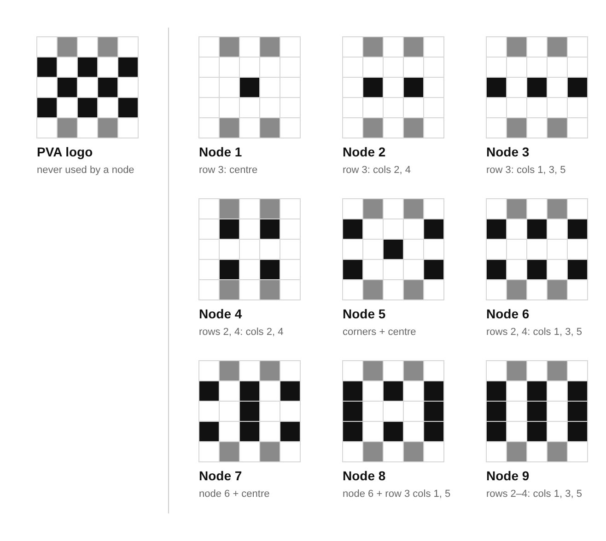

# Node logos

The nine node logos, drawn from the node number (`node` in a stamp: [stamp-format.md](../stamp-format.md) 3.2). Fixed 28 Oct 2026.

## The rule

- A 5 × 5 grid, the same as the Photovoltaic Art logo.
- **Rows 1 and 5 are always the PVA logo's:** columns 2 and 4.
- **Rows 2–4 carry the node:** node N has exactly N pixels there, so the logo can be counted.
- **No node's logo is the PVA logo,** and no two nodes share a logo. (Rows 2–4 at 1, 3, 5 / 2, 4 / 1, 3, 5 would be the PVA logo, so node 8 uses the two ends of row 3 instead.)

| Node | Row 2 | Row 3 | Row 4 |
| --- | --- | --- | --- |
| 1 | – | 3 | – |
| 2 | – | 2, 4 | – |
| 3 | – | 1, 3, 5 | – |
| 4 | 2, 4 | – | 2, 4 |
| 5 | 1, 5 | 3 | 1, 5 |
| 6 | 1, 3, 5 | – | 1, 3, 5 |
| 7 | 1, 3, 5 | 3 | 1, 3, 5 |
| 8 | 1, 3, 5 | 1, 5 | 1, 3, 5 |
| 9 | 1, 3, 5 | 1, 3, 5 | 1, 3, 5 |

Columns are numbered 1–5 from the left.

## As bits

Each row as five bits, left to right (1 = filled), for the firmware and the passport page:

| Node | Rows 1–5 |
| --- | --- |
| 1 | `01010 00000 00100 00000 01010` |
| 2 | `01010 00000 01010 00000 01010` |
| 3 | `01010 00000 10101 00000 01010` |
| 4 | `01010 01010 00000 01010 01010` |
| 5 | `01010 10001 00100 10001 01010` |
| 6 | `01010 10101 00000 10101 01010` |
| 7 | `01010 10101 00100 10101 01010` |
| 8 | `01010 10101 10001 10101 01010` |
| 9 | `01010 10101 10101 10101 01010` |
| PVA (never a node) | `01010 10101 01010 10101 01010` |

## Files

`node-1.svg` … `node-9.svg`: each logo at the PVA avatar's size and grid (420 × 420, 70 px cells). `node-logos-sheet.svg` and `.png`: the set beside the PVA logo.

## On the wall plates

The logo is **a sign to be recognised, not a code:** a phone camera cannot read a 5 × 5 pattern, and it holds only the node number. On each wall plate the node's logo sits **in the centre of the plate's QR code**, which uses the highest error correction (level H, about 30% of the code can be covered) so it still scans. Panel N carries node N's logo from SUNDIAL onwards, so one plate serves both works.

A fork keeps the same nine logos: they belong to the node numbers, not to a town.
